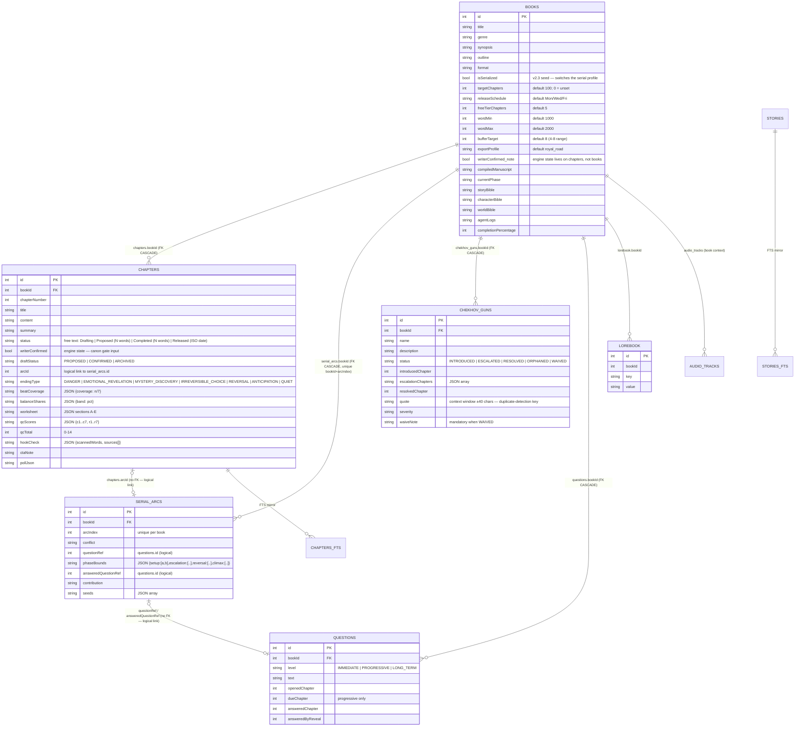

# Data Model

Room KMP database, version 15, 11 entities. Facts cite `desktop/src/main/kotlin/com/example/data/`. Mermaid ER for the core writing domain; `stories`/`audio_tracks`/`*_fts` are v2.3-legacy support tables.

## ER diagram

Full column lists: `data/model/Book.kt`, `Chapter.kt`, `SerialArc.kt`, `ChekhovGun.kt`, `QuestionEntry.kt`, `Lorebook.kt`, `Story.kt`, `AudioTrack.kt`, `PluginRecord.kt` (plugins: `id, kind, name, path, version, enabled`, unique `(kind, name)`).

## Relationships & constraints

- FKs with `ON DELETE CASCADE`: chapters / serial_arcs / chekhov_guns / questions → books (FACT: `@ForeignKey` in each entity).
- `serial_arcs` unique index `(bookId, arcIndex)` (FACT: `SerialArc.kt`).
- **No DB-level FK** for `chapters.arcId`, `serial_arcs.questionRef`, `serial_arcs.answeredQuestionRef` — logical links only (FACT: entity definitions; the completion requirement checks them in code, `MicroArcPlanner.checkArcs`).
- Legacy tables: `stories` + `stories_fts`, `chapters_fts`, `audio_tracks`, `lorebook` (v2.3 baseline; FACT: `AppDatabase` entity list).

## Migration history (FACT: `data/local/AppDatabase.kt`)

| Version | Change |
| --- | --- |
| 12→13 | `books.lastModifiedAt` (DB-side default 0; entity declares none — Room tolerates DB-side defaults) |
| 13→14 | v2.3 serial seeds: `isSerialized`, `targetChapters`, `releaseSchedule` |
| 14→15 | v3.0 schema v2 (plan Table 32 + Appendix A): serial profile columns on books; writer-confirmed engine state + serialization columns on chapters; new tables `serial_arcs`, `chekhov_guns`, `questions`, `plugins` |

## Migration rules (how to safely change schema)

1. **Additive only** — `ALTER TABLE … ADD COLUMN` / `CREATE TABLE` / `CREATE INDEX`. No column drops, no type changes, no NOT NULL without a DB-side DEFAULT.
2. Bump `AppDatabase.version` and append a new `Migration(from, to)`; register it in `getDatabase().addMigrations(...)`.
3. **Do not declare `@ColumnInfo defaultValue`** on migrated columns — Kotlin defaults govern writes; Room's `TableInfo.equalsCommon` tolerates database-side defaults (documented in `Book.kt`).
4. Unknown prefs/settings keys are ignored on migration (plan §12); legacy chapters migrate as canon (`writerConfirmed=1`, `draftStatus='CONFIRMED'` — FACT: `MIGRATION_14_15` comments).
5. `fallbackToDestructiveMigration(true)` is a safety net, not a tool — a missing migration that triggers it destroys user data (see troubleshooting).
6. Mirror every schema change into `AuthrContainer` payloads (`container/AuthrContainer.kt` toPayload/toEntity pairs) and bump the container's field set — the round-trip test pins this (`AuthrContainerRoundTripTest`).

## JSON field conventions (inside TEXT columns)

- `worksheet`: `{"A_objective","B_character","C_plot","D_reader","E_ending"}` (FACT: `PreDraftWorksheet.toJson`).
- `qcScores`: `{"c1".."c7","r1".."r7"}` (FACT: `QcScorecard.toJson`).
- `beatCoverage`: `{"coverage":"7/7"}` (FACT: WriterStudioViewModel confirm flow).
- `balanceShares`: `{"<Band name>": pct}` with band display names as keys (FACT: `BalanceMeter.balanceSharesJson`).
- `hookCheck`: `{"scannedWords":N,"sources":["…"]}` (FACT: confirm flow).
- `phaseBounds`: `{"setup":[1,3],"escalation":[4,7],"reversal":[8,11],"climax":[12,15]}` (FACT: `MicroArcPlanner.phaseBoundsJson`).
- `seeds`, `escalationChapters`: JSON string arrays.
- Serialization via `org.json` (on the JVM classpath; FACT: `desktop/build.gradle.kts`), not kotlinx-serialization, for these engine fields.
