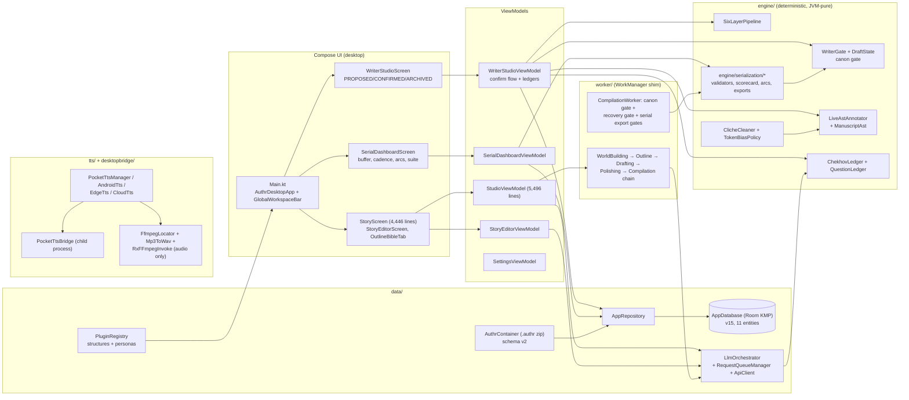

# System Map

All paths are relative to `authr-desktop/desktop/src/main/kotlin/` unless noted. Labeling per repo convention: FACT = seen in code, INFERRED = derived, UNKNOWN = needs human confirmation.

## Mermaid — components and data flow

## Modules

| Path | Responsibility | Depends on | Depended on by |
| --- | --- | --- | --- |
| `Main.kt` | App entry (`MainKt`), tab routing (0 Story, 1 Audio, 2 Translate, 3 Metadata, 5 Settings, 6 Writer Studio, 7 Serial), `GlobalWorkspaceBar`, plugin scaffold on launch | all screens + ViewModels | — (entry point) |
| `ui/screens/*` | Compose screens; `StoryScreen` is the wizard/library hub, `WriterStudioScreen` the review surface, `SerialDashboardScreen` the publication surface | ViewModels | `Main.kt` |
| `ui/viewmodel/StudioViewModel.kt` | Master VM: books/stories CRUD, wizard LLM calls, autonomous pipeline enqueue, TTS settings, logs (5,496 lines) | AppRepository, LlmOrchestrator, WorkManager shim | `Main.kt`, screens |
| `ui/viewmodel/WriterStudioViewModel.kt` | Confirm flow: freeze text → persist serialization artifacts → L6 annotate → ledger upserts → orphan sweep; queue actions; archive | AppRepository, engine/* | `WriterStudioScreen` |
| `ui/viewmodel/SerialDashboardViewModel.kt` | Publication dashboard state: recompute suite/buffer/cadence, arcs, worksheet/scorecard saves, release actions, exports | AppRepository, engine/serialization/* | `SerialDashboardScreen` |
| `engine/DraftState.kt` | Writer-sovereignty contract: `DraftState` states, `EngineLayer`, `WriterGate` (canon filter + violations) | `data/model/Chapter` | every consumer of chapters |
| `engine/ManuscriptAst.kt` | AST types: `AnnotationKind`, `Severity`, `AstAnnotation`, `ManuscriptAst`, `ChapterBeat`, `EndingTypes` | — | annotator, VMs, ledgers |
| `engine/LiveAstAnnotator.kt` | Deterministic annotator of confirmed text: beat coverage, cliché hits, promises, lore, ending signal, continuity flags; `classifyEnding` + `beatCueList` public accessors (P3) | `ClicheCleaner`, ManuscriptAst | VMs, `SixLayerPipeline` |
| `engine/SixLayerPipeline.kt` | Layer contract L1–L6, ledger upsert builder, `assertGate`, `DraftArchive` (archived-draft files) | WriterGate, ManuscriptAst | tests, VMs |
| `engine/ClicheCleaner.kt` | 154-pattern cliché matrix, 6 classes; `scan`, `offenderTokens`, `biasPayload` | — | annotator, L4 generator |
| `engine/TokenBiasPolicy.kt` | Maps offender tokens to `logit_bias` payload (−5 weight, 300-entry ceiling) | ClicheCleaner | `L4LlmDraftGenerator` |
| `engine/ChekhovLedger.kt` | Gun lifecycle (INTRODUCED/ESCALATED/RESOLVED/ORPHANED/WAIVED), upsert planning, orphan sweep, final-act `recoveryGate` | model/ChekhovGun | VMs, CompilationWorker |
| `engine/QuestionLedger.kt` | 3 information levels, expected-answer windows, overdue surfacing, revelation outcomes | model/QuestionEntry | VMs, suite |
| `engine/serialization/OpeningValidators.kt` | Hook validator (7 sources of interest), story promise, exposition runs, substantial developments, **anti-withholding gate**, outline gate, L4 opening rule | WriterGate, EndingTypes | suite, workers, VMs |
| `engine/serialization/BalanceMeter.kt` | Seven-beat segment shares vs advisory bands; word envelope; `balanceSharesJson` | LiveAstAnnotator cues | suite, VMs |
| `engine/serialization/EndingAdvisor.kt` | Ending history + consecutive high-intensity fatigue flags (never auto-assigns) | LiveAstAnnotator, OpeningValidators | suite |
| `engine/serialization/MicroArcPlanner.kt` | Arc layout (15-chapter cycles, proportional truncation), 6 planner checks, completion requirement, ship report | model/SerialArc, QuestionEntry | suite, dashboard, workers |
| `engine/serialization/PreDraftWorksheet.kt` | Worksheet A–E model, JSON round-trip, validation, auto-fill, prompt block | org.json | workers, dashboard, exports |
| `engine/serialization/QcScorecard.kt` | 7 criteria × 0–2, bands + zero-triggers + note-only overrides; ten principles + four ultimate rules | org.json | suite, dashboard, workers |
| `engine/serialization/BufferCadence.kt` | Buffer meter (8/4 thresholds), release markers, cadence tracker (schedule parse, slips, streak) | model/Book, Chapter | suite, dashboard |
| `engine/serialization/SerialExportProfiles.kt` | 6 paste-ready platform profiles, package builder, batch export | PreDraftWorksheet, OpeningValidators | dashboard |
| `engine/serialization/SerialValidatorSuite.kt` | Orchestrator: PASS/INFO/WARN(dismissable)/HARD checks over a serial project; exit-gate predicate; Autonomous draft report | all serialization engines | dashboard, CompilationWorker |
| `engine/serialization/GoldenSerial.kt` | Deterministic 15-chapter planted corpus + negative variants (withheld, beat-gap, scorecard bands) | all serialization engines | tests, probes |
| `engine/audio/PronunciationPass.kt` | IPA pass (P4, plan §7.3): candidate scan (lorebook / mid-sentence capitals / coined tokens; possessives & contractions excluded), espeak-ng phonemizer, deterministic IPA→respelling table (maximal-onset syllabification), pre-synthesis normalization (approved rules only) | AuthrContainer rules, Chapter, EspeakLocator | audiobook renderer, tests |
| `engine/audio/MasteringChain.kt` | Three-layer ffmpeg chain (P4, plan §7.5/Table 25): layer-1 sidechain bed ducking (−12 dB, 400 ms release, skipped bedless), layer-2 loudnorm I=−18 LUFS, layer-3 alimiter −3.1 dBFS; WAV concat; MP3 CBR 192 kbps delivery encode. `open` for test fakes | FfmpegLocator, ProcessBuilder | AudiobookRenderer, tests |
| `engine/audio/AcxAudit.kt` | Retail audit (P4, plan §7.6): five criteria red/green with measured values — RMS −23..−18 dB (astats), true peak ≤ −3 dBFS (ebur128), noise floor ≤ −60 dB (min per-window RMS via ametadata), 44.1 kHz, MP3 CBR ≥ 192 kbps (ffprobe) | FfmpegLocator | AudiobookRenderer, tests, gate |
| `engine/audio/SmilExporter.kt` | Read-along export (P4, plan §7.6): fragment split (paragraphs, sentence-split long ones), SMIL 3.0 overlay + paired EPUB XHTML, timing sanity check (contiguous, full coverage, last clipEnd == duration) | — | AudiobookRenderer, tests |
| `engine/audio/AudiobookRenderer.kt` | Orchestrator (P4, plan §7): canon-only render → normalize → per-fragment synthesis (measured clip times; `Synthesizer` interface, continuity-mode contract) → join → chain per chapter + once more across master (layers 2-3) → ACX audit per chapter + master → SMIL; render report records engine, continuity mode, temperature, synthesis-speed factor. `EspeakSynthesizer` = bundled-local render engine | WriterGate, all engine/audio | tests, gate (`AudiobookGate.kt`) |
| `engine/publishing/PublishingMetadata.kt` | Metadata workbench + pricing simulator (P5, plan §11.2): KDP fields (title/subtitle/7 keywords/blurb/categories/pricing), per-platform blurb variants, 70%/35% eBook quotes (band $2.99–$12.99, per-MB delivery) + 60% print quotes vs $0.85+$0.012/page cost; `WorkbenchStore` reads the structured `kdp_workbench.json` AND the legacy v2.3 string stub | kotlinx.serialization, org.json fallback | RetailPackager, AuthrContainer |
| `engine/publishing/Epub3Exporter.kt` | EPUB 3.2 writer (P5, plan §11.1): mimetype-first OCF zip, package doc with dcterms:modified + dc:subject keywords + belongs-to-collection, nav.xhtml in manifest+spine, semantic chapter XHTML, cover slot | java.util.zip | RetailPackager, VolumeBundler |
| `engine/publishing/PrintInterior.kt` | Print interior (P5, plan §11.1): 6×9 in PDFBox render, gutter ladder (24–150→0.375 in … 501–700→0.75 in) applied by iterative pagination, mirrored recto/verso margins, front matter, embedded TTF serif (DejaVu default) | pdfbox | RetailPackager, gate band probes |
| `engine/publishing/VolumeBundler.kt` | Volume bundling (P5, §13/§6.13): serial canon chapters grouped per micro-arc (size fallback), every volume exported through the same EPUB 3 pipeline | Epub3Exporter, model/SerialArc | RetailPackager |
| `engine/publishing/ShipReport.kt` | Ship report (P5, plan §15): artifacts + gate verdicts + Chekhov waivers with mandatory notes + scorecard notes + cadence + pricing record; clean ⟺ every verdict passed (UNVERIFIED is not clean) | ChekhovLedger constants | RetailPackager |
| `engine/publishing/RetailPackager.kt` | One-action orchestrator (P5, plan §13): writer gate → workbench resolution (OQ-9 authority) → EPUB(s) → epubcheck (external, blocking; UNVERIFIED ≠ clean) → print interior → pricing → metadata.json + ship-report.md | WriterGate, all engine/publishing, EpubCheckLocator | tests, gate (`PublishingGate.kt`); app UI pending (D-15) |
| `data/repository/AppRepository.kt` | Single data facade over all DAOs (nullable ledger/arc DAOs keep JVM tests Room-free) | all DAOs | ViewModels, workers |
| `data/local/AppDatabase.kt` | Room KMP DB, v15, 11 entities, migrations 12→15, `fallbackToDestructiveMigration(true)` | entities | repository |
| `data/local/*Dao.kt` | DAOs: Story, AudioTrack, Book, Chapter, Lorebook, SerialArc, ChekhovGun, Question, Plugin | models | repository |
| `data/model/*.kt` | Room entities + FTS: Book (serial profile fields), Chapter (engine state + serialization fields), SerialArc, ChekhovGun, QuestionEntry, PluginRecord… | — | DB, container, engine |
| `data/api/LlmOrchestrator.kt` | 6 agents × 7 providers, per-agent provider prefs, failover sequence, `logitBias` passthrough (P2) | ApiService, BuildConfig, RequestQueueManager | workers, VMs, L4 generator |
| `data/api/RequestQueueManager.kt` | Global request queue: priority + `Semaphore` concurrency limit, persisted request accounting (failed requests are saved and counted but NEVER replayed — no replay path exists) | ApiService | LlmOrchestrator |
| `data/api/ApiService.kt` | Retrofit interfaces + models for Gemini/Ollama/Mistral/HF/OpenRouter/OpenAI-compatible | Retrofit/Moshi | orchestrator, discovery |
| `data/api/ModelDiscoveryService.kt` | Live model listing per provider (settings UI) | ApiService | SettingsViewModel |
| `container/AuthrContainer.kt` | `.authr` zip interchange (schema v2): export/import, v1→v2 migration, backup | models, org.json | tests (`AuthrContainerRoundTripTest`) |
| `plugins/PluginRegistry.kt` | Structure/persona JSON plugins under `<authr>/plugins/{structures,personas}`, scaffold of shipped defaults | ShippedPlugins, PluginSchema | `Main.kt`, drafting prompts |
| `worker/*.kt` | CoroutineWorkers: WorldBuilding, Outline (serial outline gate), Drafting (Blueprint 2.0 block), Polishing, Compilation (canon + recovery + serial gates), EpubExport, StorageCleanup, WorkerUtils (`logAgentChat`, `retryWithBackoff`) | DAOs, engine, orchestrator | WorkManager shim chains |
| `androidx/work/WorkManager.kt` | Ported WorkManager shim: chains, periodic jobs, `runSingle` via registered factories; **no factories registered anywhere → chains no-op (see tech-debt)** | — | ViewModels/workers |
| `tts/*.kt` | PocketTtsManager (local), AndroidTtsManager, EdgeTtsManager, CloudTtsManager | desktopbridge, BuildConfig | AudioScreen/VMs |
| `desktopbridge/PocketTtsBridge.kt` | Pocket TTS child-process bridge; binary resolution: bundled → `POCKET_TTS_BIN` → PATH → `~/.authr/pocket-tts` | ProcessBuilder | PocketTtsManager |
| `desktopbridge/FfmpegLocator.kt` | ffmpeg resolution: bundled → `FFMPEG_HOME` → PATH | — | audio workers |
| `desktopbridge/EspeakLocator.kt` | espeak-ng resolution (P4, plan §7.3 phonemizer): bundled → `ESPEAK_NG_BIN` → PATH → `~/.authr/espeak-ng`; accepts legacy `espeak` name | — | PronunciationPass, EspeakSynthesizer |
| `desktopbridge/EpubCheckLocator.kt` | epubcheck resolution (P5, plan §11.1 external EPUB 3 gate): `EPUBCHECK_JAR` → `EPUBCHECK_HOME` → app dir → `~/.authr`; verdict parsed from the tool's own "Messages:" summary | ProcessBuilder | RetailPackager.runEpubCheck |
| `utils/*` | EpubUtils/EpubManager, AudioEncoder/Mixer, WavUtils, ZipUtils, LocalVectorRag, JsonStructuralEnforcer, TxtManager | — | workers, VMs |

## Entry points

- **App**: `Main.kt` → `fun main()` → `com.example.MainKt` (FACT: `compose.desktop.application.mainClass = "com.example.MainKt"` in `desktop/build.gradle.kts`).
- **Test**: `gradle :desktop:test` over `desktop/src/test/kotlin/com/example/`.
- **Distribution**: `gradle :desktop:createDistributable` → `desktop/build/compose/binaries/main/app/AuthrOS/` (FACT).

## Background jobs

FACT: the ViewModels enqueue a 5-worker chain — `WorldBuildingWorker → OutlineWorker → DraftingWorker → PolishingWorker → CompilationWorker` (e.g. `StudioViewModel.kt` ≈ line 4180) — plus `EpubExportWorker` and periodic `StorageCleanupWorker`, all through the ported WorkManager shim.
INFERRED/CRITICAL: the shim's `runSingle` (`androidx/work/WorkManager.kt` ≈ line 480) requires a factory registered via `DesktopWorkManager.registerWorker(...)`, and **no call site registers any worker** — so these chains log `"No factory for …; is it registered in the DI module?"` and stop. The workers' *logic* is still the enforcement seam spec (gates at the same points as tests) but does not execute on desktop. See `docs/tech-debt.md` D-01 and `docs/troubleshooting.md` T-09.

## External services

FACT (`data/api/ApiService.kt` base URLs + `LlmOrchestrator.kt`):
- Gemini `https://generativelanguage.googleapis.com/`
- Ollama `https://api.ollama.com/` (configurable base URL)
- Mistral `https://api.mistral.ai/`
- HuggingFace inference `https://api-inference.huggingface.co/` (translation features)
- OpenRouter `https://openrouter.ai/`
- OpenAI-compatible (Groq `https://api.groq.com/openai/v1/…`, NVIDIA `https://integrate.api.nvidia.com/v1/…`, Custom base URL)
- Pocket TTS local binary (no network), Edge TTS (network, `tts/EdgeTtsManager.kt`), ElevenLabs/Google TTS keys via BuildConfig (FACT: `BuildConfig.kt`).
