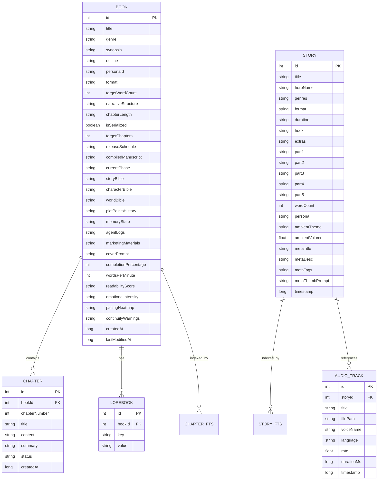

# Data Model & Storage Schema

## Database Overview
- **Database Engine**: Room (SQLite), version **14** (`AppDatabase.kt:17`). [FACT]
- **Database File Name**: `audio_novel_studio_db` (`AppDatabase.kt:48`). [FACT]
- **Export Schema**: `exportSchema = false` (`AppDatabase.kt:17`). [FACT]
- **Destructive Fallback**: `fallbackToDestructiveMigration(true)` (`AppDatabase.kt:51`). [FACT]

---

## Entity Relationship Diagram



---

## Tables & Constraints

### 1. `books` (`com.example.data.model.Book`)
- **Primary Key**: `id` (`INTEGER NOT NULL PRIMARY KEY AUTOINCREMENT`). [FACT]
- **Columns**:
  - `title` (`TEXT NOT NULL`)
  - `genre` (`TEXT NOT NULL`)
  - `synopsis` (`TEXT NOT NULL`)
  - `outline` (`TEXT NOT NULL`)
  - `personaId` (`TEXT NOT NULL DEFAULT 'standard'`)
  - `format` (`TEXT NOT NULL DEFAULT 'Novel'`)
  - `targetWordCount` (`INTEGER NOT NULL DEFAULT 50000`)
  - `narrativeStructure` (`TEXT NOT NULL DEFAULT "Hero's Journey"`)
  - `chapterLength` (`TEXT NOT NULL DEFAULT 'Medium (3000 words)'`)
  - `isSerialized` (`INTEGER NOT NULL DEFAULT 0`)
  - `targetChapters` (`INTEGER NOT NULL DEFAULT 0`)
  - `releaseSchedule` (`TEXT NOT NULL DEFAULT 'Mon/Wed/Fri'`)
  - `compiledManuscript` (`TEXT NOT NULL DEFAULT ''`)
  - `currentPhase` (`TEXT NOT NULL DEFAULT 'Outlining'`)
  - `storyBible` (`TEXT NOT NULL DEFAULT ''`)
  - `characterBible` (`TEXT NOT NULL DEFAULT ''`)
  - `worldBible` (`TEXT NOT NULL DEFAULT ''`)
  - `plotPointsHistory` (`TEXT NOT NULL DEFAULT ''`)
  - `memoryState` (`TEXT NOT NULL DEFAULT ''`)
  - `agentLogs` (`TEXT NOT NULL DEFAULT ''`)
  - `marketingMaterials` (`TEXT NOT NULL DEFAULT ''`)
  - `coverPrompt` (`TEXT NOT NULL DEFAULT ''`)
  - `completionPercentage` (`INTEGER NOT NULL DEFAULT 0`)
  - `wordsPerMinute` (`INTEGER NOT NULL DEFAULT 230`)
  - `readabilityScore` (`TEXT NOT NULL DEFAULT 'Flesch-Kincaid: Grade 7'`)
  - `emotionalIntensity` (`TEXT NOT NULL DEFAULT 'Balanced'`)
  - `pacingHeatmap` (`TEXT NOT NULL DEFAULT 'Moderate'`)
  - `continuityWarnings` (`TEXT NOT NULL DEFAULT 'No critical warnings'`)
  - `createdAt` (`INTEGER NOT NULL`)
  - `lastModifiedAt` (`INTEGER NOT NULL`)

### 2. `chapters` (`com.example.data.model.Chapter`)
- **Primary Key**: `id` (`INTEGER NOT NULL PRIMARY KEY AUTOINCREMENT`). [FACT]
- **Foreign Key**: `bookId` references `books(id)` on delete **CASCADE** (`Chapter.kt:10-17`). [FACT]
- **Index**: `Index(value = ["bookId"])` (`Chapter.kt:18`). [FACT]
- **Columns**: `chapterNumber` (`INTEGER NOT NULL`), `title` (`TEXT NOT NULL`), `content` (`TEXT NOT NULL`), `summary` (`TEXT NOT NULL`), `status` (`TEXT NOT NULL DEFAULT 'Drafting'`), `createdAt` (`INTEGER NOT NULL`).

### 3. `lorebook` (`com.example.data.model.Lorebook`)
- **Primary Key**: `id` (`INTEGER NOT NULL PRIMARY KEY AUTOINCREMENT`). [FACT]
- **Foreign Key**: `bookId` references `books(id)` on delete **CASCADE** (`Lorebook.kt:10-17`). [FACT]
- **Index**: `Index(value = ["bookId"])` (`Lorebook.kt:18`). [FACT]
- **Columns**: `key` (`TEXT NOT NULL`), `value` (`TEXT NOT NULL`).

### 4. `stories` (`com.example.data.model.Story`)
- **Primary Key**: `id` (`INTEGER NOT NULL PRIMARY KEY AUTOINCREMENT`). [FACT]
- **Columns**: `title`, `heroName`, `genres`, `format`, `duration`, `hook`, `extras`, `part1`, `part2`, `part3`, `part4`, `part5`, `wordCount`, `persona`, `ambientTheme`, `ambientVolume`, `metaTitle`, `metaDesc`, `metaTags`, `metaThumbPrompt`, `timestamp`. Legacy 5-part Interactive Wizard table. [FACT]

### 5. `audio_tracks` (`com.example.data.model.AudioTrack`)
- **Primary Key**: `id` (`INTEGER NOT NULL PRIMARY KEY AUTOINCREMENT`). [FACT]
- **Nullable Reference**: `storyId` (`INTEGER? = null`). [FACT]
- **Columns**: `title`, `filePath`, `voiceName`, `language`, `rate`, `durationMs`, `timestamp`.

### 6. Full-Text Search Virtual Tables
- `chapters_fts` (`ChapterFts.kt`): FTS4 virtual table mapping `title`, `content`, `summary`. [FACT]
- `stories_fts` (`StoryFts.kt`): FTS4 virtual table mapping `title`, `hook`, `part1`, `part2`, `part3`, `part4`, `part5`. [FACT]

---

## Migration Rules & Procedures

To add or modify any column safely:
1. Increment the database `version` in `AppDatabase.kt:17` (e.g. `14 -> 15`).
2. Define a migration object:
   ```kotlin
   val MIGRATION_14_15 = object : Migration(14, 15) {
       override fun migrate(db: SupportSQLiteDatabase) {
           db.execSQL("ALTER TABLE books ADD COLUMN new_feature INTEGER NOT NULL DEFAULT 0")
       }
   }
   ```
3. Register it in `.addMigrations(MIGRATION_12_13, MIGRATION_13_14, MIGRATION_14_15)` in `AppDatabase.kt:50`.
4. Run `gradle :app:testDebugUnitTest` to verify SQLite schema integrity.
- **WARNING**: Do NOT rely on `fallbackToDestructiveMigration(true)` in production; it will drop all user manuscripts. [FACT]
