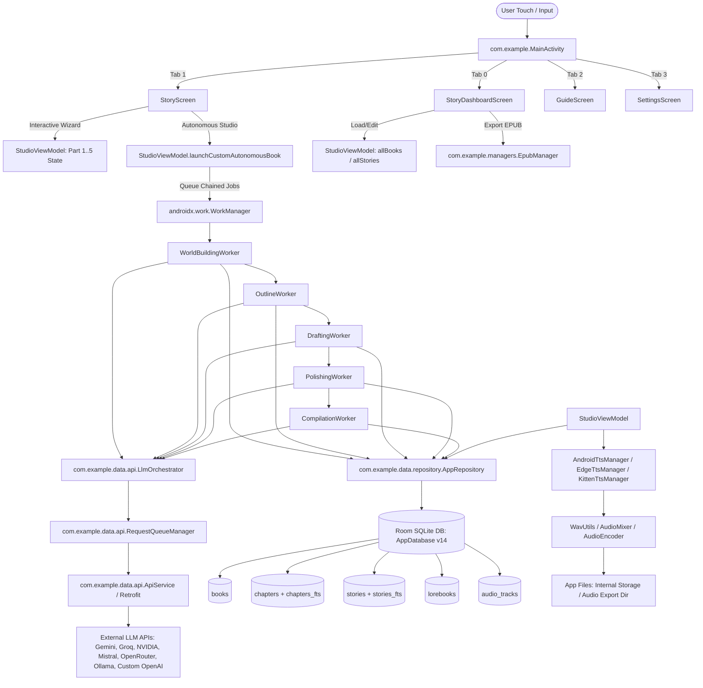

# System Map

## Architecture Overview & Data Flow

---

## Module Table

| Path | Responsibility | Depends On | Depended On By | Status |
|---|---|---|---|---|
| `com.example.MainActivity` (`app/src/main/java/com/example/MainActivity.kt`) | App root entry point, tab hosting (`StoryDashboardScreen`, `StoryScreen`, `GuideScreen`, `SettingsScreen`), permissions launcher, wide-screen NavigationRail. | `StudioViewModel`, `SettingsViewModel`, `StoryEditorViewModel` | Android OS Launcher | FACT |
| `com.example.StudioApplication` (`app/src/main/java/com/example/StudioApplication.kt`) | Application subclass initializing Koin DI, custom `KoinWorkerFactory` for WorkManager. | `appModule`, `KoinWorkerFactory` | Android OS | FACT |
| `com.example.di.AppModule` (`app/src/main/java/com/example/di/AppModule.kt`) | Koin dependency definitions for Database, DAOs, Repository, UseCases, Workers, and ViewModels. | `AppDatabase`, `AppRepository`, `Workers`, `ViewModels` | `StudioApplication` | FACT |
| `com.example.ui.screens.StoryDashboardScreen` (`app/src/main/java/com/example/ui/screens/StoryDashboardScreen.kt`) | Library management, project list, chapter list review, project deletion, EPUB export launcher. | `StudioViewModel`, `EpubManager`, `Book`, `Story` | `MainActivity` | FACT |
| `com.example.ui.screens.StoryScreen` (`app/src/main/java/com/example/ui/screens/StoryScreen.kt`) | Primary workspace containing Interactive Wizard (Tab 0) and Autonomous Studio (Tab 1). | `StudioViewModel`, `DistractionFreeManuscriptEditor`, `PresetRepository` | `MainActivity` | FACT |
| `com.example.ui.screens.SettingsScreen` (`app/src/main/java/com/example/ui/screens/SettingsScreen.kt`) | API key management, custom OpenAI/Ollama base URLs, TTS engine selection, Theme selection, author metadata. | `SettingsViewModel` | `MainActivity` | FACT |
| `com.example.ui.screens.GuideScreen` (`app/src/main/java/com/example/ui/screens/GuideScreen.kt`) | In-app user manual and workflow guide. | None (Compose UI) | `MainActivity` | FACT |
| `com.example.ui.viewmodel.StudioViewModel` (`app/src/main/java/com/example/ui/viewmodel/StudioViewModel.kt`) | Primary application state engine (6661 lines). Manages UI state, WorkManager sequencing, TTS conversion, audio playback, video rendering, pronunciation rules. | `AppRepository`, `GetChaptersUseCase`, `GenerateStoryUseCase`, `WorkManager` | `MainActivity`, `StoryDashboardScreen`, `StoryScreen` | FACT |
| `com.example.ui.viewmodel.SettingsViewModel` (`app/src/main/java/com/example/ui/viewmodel/SettingsViewModel.kt`) | Settings state, encrypted preferences bridge, periodic storage cleanup scheduler. | `EncryptedSharedPreferences`, `WorkManager` | `SettingsScreen`, `MainActivity` | FACT |
| `com.example.worker.WorldBuildingWorker` (`app/src/main/java/com/example/worker/WorldBuildingWorker.kt`) | Stage 1 Autonomous pipeline: generates character Bible, world Bible, and seeds `Lorebook` entries. | `AppRepository`, `LlmOrchestrator` | WorkManager | FACT |
| `com.example.worker.OutlineWorker` (`app/src/main/java/com/example/worker/OutlineWorker.kt`) | Stage 2 Autonomous pipeline: generates chapter structure, seeds `Chapter` entries. | `AppRepository`, `LlmOrchestrator` | WorkManager | FACT |
| `com.example.worker.DraftingWorker` (`app/src/main/java/com/example/worker/DraftingWorker.kt`) | Stage 3 Autonomous pipeline: writes prose chapter-by-chapter using RAG memory & continuity rules. | `AppRepository`, `LlmOrchestrator`, `LocalVectorRag` | WorkManager | FACT |
| `com.example.worker.PolishingWorker` (`app/src/main/java/com/example/worker/PolishingWorker.kt`) | Stage 4 Autonomous pipeline: continuity pass, pacing, and chapter polishing. | `AppRepository`, `LlmOrchestrator` | WorkManager | FACT |
| `com.example.worker.CompilationWorker` (`app/src/main/java/com/example/worker/CompilationWorker.kt`) | Stage 5 Autonomous pipeline: concatenates manuscript, computes readability, generates cover/marketing copy, optionally triggers EPUB export. | `AppRepository`, `LlmOrchestrator`, `EpubManager` | WorkManager | FACT |
| `com.example.worker.EpubExportWorker` (`app/src/main/java/com/example/worker/EpubExportWorker.kt`) | Background WorkManager worker for compiling and exporting EPUB files asynchronously from Book or Story drafts. | `AppRepository`, `EpubManager` | WorkManager, `StudioViewModel` | FACT |
| `com.example.worker.StorageCleanupWorker` (`app/src/main/java/com/example/worker/StorageCleanupWorker.kt`) | Background maintenance worker: purges temporary audio files and trims oldest projects if max projects exceeded. | `AppRepository`, Room `SupportSQLiteDatabase` | WorkManager (Periodic or OneTime) | FACT |
| `com.example.data.api.ModelDiscoveryService` (`app/src/main/java/com/example/data/api/ModelDiscoveryService.kt`) | Dynamic provider model discovery service querying live endpoints for Groq, NVIDIA, Mistral, OpenRouter, Gemini, Ollama, and Custom OpenAI with intelligent caching and fallback lists. | `ApiService`, `EncryptedSharedPreferences` | `SettingsViewModel` | FACT |
| `com.example.data.api.LlmOrchestrator` (`app/src/main/java/com/example/data/api/LlmOrchestrator.kt`) | Central LLM dispatcher with 6 specialized agents, key resolution, and provider fallback loop. | `RequestQueueManager`, `ApiService`, `EncryptedSharedPreferences` | All Workers, `StudioViewModel` | FACT |
| `com.example.data.api.RequestQueueManager` (`app/src/main/java/com/example/data/api/RequestQueueManager.kt`) | Priority queue (`HIGH`, `NORMAL`, `LOW`), concurrency limiter (`Semaphore(2)`), and rate limiter (`15 RPM`). | Kotlin Coroutines | `LlmOrchestrator` | FACT |
| `com.example.data.api.ApiService` (`app/src/main/java/com/example/data/api/ApiService.kt`) | Retrofit interfaces for Gemini, Mistral, Ollama, OpenRouter, Groq, NVIDIA, Custom OpenAI, Hugging Face. | Retrofit, OkHttp | `LlmOrchestrator`, `StudioViewModel` | FACT |
| `com.example.data.local.AppDatabase` (`app/src/main/java/com/example/data/local/AppDatabase.kt`) | Room SQLite database (version 14) with entities `Story`, `StoryFts`, `AudioTrack`, `Book`, `Chapter`, `ChapterFts`, `Lorebook`. | Room Runtime | `AppRepository` | FACT |
| `com.example.data.repository.AppRepository` (`app/src/main/java/com/example/data/repository/AppRepository.kt`) | Unified repository layer providing CRUD and Flow streams across all 5 database DAOs. | `StoryDao`, `AudioTrackDao`, `BookDao`, `ChapterDao`, `LorebookDao` | ViewModels, Workers | FACT |
| `com.example.managers.EpubManager` (`app/src/main/java/com/example/managers/EpubManager.kt`) | EPUB 3 generator (OEBPS, content.opf, toc.ncx, XHTML chapters, CSS styling, cover embedding). | File I/O, `ZipOutputStream` | `StudioViewModel`, `CompilationWorker`, `StoryDashboardScreen` | FACT |
| `com.example.tts.AndroidTtsManager` (`app/src/main/java/com/example/tts/AndroidTtsManager.kt`) | Device native TTS synthesis wrapper. | `android.speech.tts.TextToSpeech` | `StudioViewModel` | FACT |
| `com.example.tts.EdgeTtsManager` (`app/src/main/java/com/example/tts/EdgeTtsManager.kt`) | Microsoft Edge TTS WebSocket synthesis engine. | OkHttp WebSocket | `StudioViewModel` | FACT |
| `com.example.tts.KittenTtsManager` (`app/src/main/java/com/example/tts/KittenTtsManager.kt`) | Cloud-based Hugging Face Gradio TTS client. | HttpURLConnection / JSON | `StudioViewModel` | FACT |
| `com.example.utils.WavUtils` (`app/src/main/java/com/example/utils/WavUtils.kt`) | Audio DSP, 16-bit PCM WAV concatenation, volume normalization, ambient sound mixing. | Java File I/O, ByteStreams | `StudioViewModel` | FACT |

---

## Entry Points, Background Jobs & External Services

### Entry Points
- **UI Entry Point**: `MainActivity` (`com.example.MainActivity`) defined in `app/src/main/AndroidManifest.xml:24-34` with action `android.intent.action.MAIN` and category `android.intent.category.LAUNCHER`. [FACT]
- **App Startup Provider**: `androidx.startup.InitializationProvider` in `AndroidManifest.xml:42-51` disables standard `WorkManagerInitializer` to allow Koin custom worker initialization. [FACT]

### Background Jobs & Services
- **Foreground Service**: `StudioForegroundService` (`com.example.service.StudioForegroundService`) declared in `AndroidManifest.xml:35-40` with `foregroundServiceType="specialUse"` (`PROPERTY_SPECIAL_USE_FGS_SUBTYPE="Video generation and TTS synthesis"`). [FACT]
- **WorkManager Jobs**:
  - `drafting_work_$bookId`: Chained sequence: `WorldBuildingWorker` -> `OutlineWorker` -> `DraftingWorker` -> `PolishingWorker` -> `CompilationWorker` (`StudioViewModel.kt:5363-5369`). [FACT]
  - Periodic Maintenance: `PeriodicWorkRequestBuilder<StorageCleanupWorker>(7, TimeUnit.DAYS)` (`StudioViewModel.kt:1200`, `SettingsViewModel.kt:308`). [FACT]

### External Services
- **Gemini API**: Google Generative Language API endpoint (`https://generativelanguage.googleapis.com/`) (`ApiService.kt:29`). [FACT]
- **Groq API**: `https://api.groq.com/openai/v1/` (`ApiService.kt:76`). [FACT]
- **NVIDIA NIM API**: `https://integrate.api.nvidia.com/v1/` (`SettingsScreen.kt:333`, `ApiService.kt:76`). [FACT]
- **Mistral API**: `https://api.mistral.ai/v1/` (`ApiService.kt:65`). [FACT]
- **OpenRouter API**: `https://openrouter.ai/api/v1/` (`ApiService.kt:76`). [FACT]
- **Ollama API**: Configurable URL (default `http://localhost:11434` or cloud endpoint) (`SettingsViewModel.kt:53`, `ApiService.kt:53`). [FACT]
- **Hugging Face Inference**: `https://api-inference.huggingface.co/` for Cloud TTS (`ApiService.kt:98`). [FACT]
