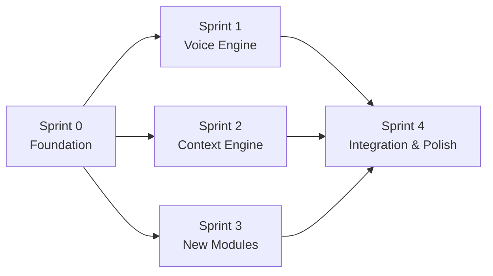

# AUTHR OS v3.0 — Implementation Roadmap

*Phased delivery plan from v2.1 baseline to v3.0 release*

---

## 1. Delivery Philosophy

- **Extend, don't replace.** Every enhancement integrates into the existing v2.1 architecture. No rewrites of working modules.
- **Schema first, then code.** Run the v2.2 migration before writing any enhancement logic.
- **One invariant at a time.** Each sprint adds invariants incrementally. All existing invariants (1–14) remain enforced throughout.
- **Test at every gate.** `test_blueprint_v2.py` is extended per sprint. No sprint ships without green tests.

---

## 2. Sprint Plan

> [!NOTE]
> Sprints 1, 2, and 3 can run in parallel after Sprint 0 completes. Sprint 4 integrates everything.

---

## 3. Sprint 0: Foundation & Schema Migration (Week 1–2)

### Goal
Validate the v2.1 baseline works, run the v2.2 schema migration, and establish the testing framework for v3 enhancements.

### Tasks

| # | Task | File(s) | Acceptance Criteria |
|:---|:---|:---|:---|
| 0.1 | **Audit existing codebase** — Verify all v2.1 modules, ADRs, and invariants are implemented and passing | All | `test_blueprint_v2.py` passes with 0 failures |
| 0.2 | **Run Schema v2.2 migration** — Execute additive migration, verify all 8 new tables created, 4 columns added | `db_engine.py` | Migration returns 0 errors; backup created per ADR-0002 |
| 0.3 | **Add v3 test scaffolding** — Extend `test_blueprint_v2.py` with test stubs for all v3 invariants (15–18) | `test_blueprint_v2.py` | Test stubs exist and skip gracefully until implemented |
| 0.4 | **Verify existing L1–L6 pipeline** — Run a complete book generation cycle (3-chapter test book) through L1–L6 | `pipeline_service.js` | 3 chapters generated, scored, and exportable |
| 0.5 | **Document integration test protocol** — Define how each sprint's output is verified end-to-end | `docs/testing_v3.md` | Protocol document reviewed |

### Deliverables
- Schema v2.2 applied to test project
- Test suite baseline (all v2.1 tests green, v3 stubs in place)
- Existing pipeline verified working

---

## 4. Sprint 1: Voice Engine Enhancements (Week 2–4)

### Goal
Add cumulative drift tracking, expanded feature extraction (20+ metrics), intentional voice evolution, and the dialogue sub-engine.

### Tasks

| # | Task | File(s) | Acceptance Criteria |
|:---|:---|:---|:---|
| 1.1 | **Implement 20+ feature extractor** — Build `extract_full_features()` in `retention_and_editorial.py` | `retention_and_editorial.py` | All 20 features computed for test chapter; values within expected ranges |
| 1.2 | **Store features per beat** — Write `featureVector` JSON to `chapter_beats.featureVector` after L5 pass | `retention_and_editorial.py`, `pipeline_service.js` | Feature vectors persisted; retrievable via API |
| 1.3 | **Implement cumulative drift tracking** — Build `compute_cumulative_drift()` with EMA ($\alpha=0.1$) | `retention_and_editorial.py` | Drift logged to `voice_drift_log`; cumulative updates correctly |
| 1.4 | **Implement voice evolution** — Build evolution-aware drift suppression; update `chapters.cumulativeVoiceDrift` on confirmation | `retention_and_editorial.py` | Author-declared evolution suppresses false drift alerts |
| 1.5 | **Build dialogue sub-engine** — Create `dialogue_director.md` role, wire into WEAVER_5, implement pairwise voice similarity check | `roles/dialogue_director.md`, `subagents.py`, `retention_and_editorial.py` | Multi-character dialogue scenes show measurable voice differentiation (similarity < 0.70) |
| 1.6 | **Add Invariant 15 gate** — Wire cumulative drift check into L6 post-confirmation flow | `pipeline_service.js` | Chapters with cumulative drift > 0.20 trigger warning in UI; evolution-covered chapters pass |
| 1.7 | **Extend test suite** — Tests for all voice engine enhancements | `test_blueprint_v2.py` | All new tests pass; existing tests unaffected |

### Dependencies
- Sprint 0 complete (schema v2.2 applied)

### Risks
| Risk | Mitigation |
|:---|:---|
| spaCy feature extraction too slow for real-time | Batch extract after L5, not during generation |
| Feature tolerances poorly calibrated | Start with wide bands (±30%), narrow per genre with real data |
| Dialogue differentiation unreliable | Start as `warning` not `blocking`; collect data before promoting |

---

## 5. Sprint 2: Context Orchestrator Enhancements (Week 2–4)

### Goal
Replace the flat 4,500 token cap with hierarchical summarization, freshness-ranked sliding windows, and stage-aware token budget allocation.

### Tasks

| # | Task | File(s) | Acceptance Criteria |
|:---|:---|:---|:---|
| 2.1 | **Implement summary generator** — Build `generate_summary()` for 4 compression levels (full/medium/brief/oneliner) | `rag_engine.py` | Summaries at each level produced with correct compression ratio |
| 2.2 | **Implement summary cache** — Build cache with SHA-256 invalidation, upsert on regeneration | `rag_engine.py`, `db_engine.py` | Cache hits return instantly; stale entries regenerated |
| 2.3 | **Implement freshness-ranked sliding window** — Build `assemble_recent_manuscript()` with decay | `rag_engine.py` | N-1 = full, N-2 = medium, N-5 = brief, N-6+ = oneliner |
| 2.4 | **Implement token budget allocator** — Build `allocate_token_budget()` with stage-specific rebalancing | `orchestrator.js` or `rag_engine.py` | Budget allocations match spec per stage; total ≤ model limit |
| 2.5 | **Implement full context assembler** — Build `assemble_context()` integrating all 9 layers | `orchestrator.js` | Assembled context includes all layers; fits within budget |
| 2.6 | **Add Invariant 16 gate** — Context overflow protection with automatic compression fallback | `orchestrator.js` | Over-budget contexts auto-compress; never exceed model limit |
| 2.7 | **Implement context budget logging** — Write to `context_budget_log` on every invocation | `orchestrator.js` | Budget logs retrievable for analysis |
| 2.8 | **Extend test suite** — Budget allocation tests, cache invalidation tests, overflow tests | `test_blueprint_v2.py` | All new tests pass |

### Dependencies
- Sprint 0 complete (schema v2.2 applied)

### Risks
| Risk | Mitigation |
|:---|:---|
| Summary quality degrades important details | Include "preserve these entities" list in summary prompt |
| Cache invalidation misses (stale summary served) | source_hash is SHA-256 of raw content; conservative invalidation |
| Token counting mismatch between estimator and model | Calibrate with model-specific tokenizer; 10% buffer allocation |

---

## 6. Sprint 3: New Modules (Week 3–5)

### Goal
Build the Research Vault, Compliance Gate, and Token Budget Engine as new modules.

### Tasks

| # | Task | File(s) | Acceptance Criteria |
|:---|:---|:---|:---|
| 3.1 | **Build Research Vault** — Source ingestion, fact extraction, chapter linking | `research_vault.py` | Sources ingestible (URL, PDF, note); facts extracted and tagged |
| 3.2 | **Build citation verification** — Cross-check cited facts against stored sources | `research_vault.py` | Unverified citations flagged; bibliography generated |
| 3.3 | **Add Invariant 17 gate** — Block NONFICTION_AUTHORITY export if unverified citations | `research_vault.py`, `pipeline_service.js` | Non-fiction export blocked with unverified facts |
| 3.4 | **Build Compliance Gate** — Plagiarism, trademark, sensitivity, AI disclosure checks | `compliance_gate.py` | All 4 check types produce results; blocking findings stop export |
| 3.5 | **Add Invariant 18 gate** — Block retail compilation if blocking compliance findings | `compliance_gate.py`, `pipeline_service.js` | Export blocked with unresolved blocking findings |
| 3.6 | **Build Token Budget Engine** — Cost estimation, model selection, spend tracking | `token_budget.py` | Stage costs estimated; actual spend logged to `token_spend_ledger` |
| 3.7 | **Build Research Workspace UI** — Source browser, citation manager, fact-check status | `ResearchWorkspace.jsx` | Sources visible, facts checkable, bibliography exportable |
| 3.8 | **Extend Publishing Workspace** — Compliance gate UI before export | `PublishingWorkspace.jsx` | Compliance results shown; export button disabled if blocking |
| 3.9 | **Extend test suite** | `test_blueprint_v2.py` | All new tests pass |

### Dependencies
- Sprint 0 complete

### Risks
| Risk | Mitigation |
|:---|:---|
| Plagiarism detection requires large reference corpus | Start with n-gram self-similarity only; add external APIs in v3.1 |
| Trademark screening has no free API | Regex against known brand databases; manual review for edge cases |
| Research vault adds complexity for fiction authors | Module is opt-in; only NONFICTION_AUTHORITY enforces citations |

---

## 7. Sprint 4: Integration & Polish (Week 5–6)

### Goal
Integrate all v3 enhancements into the full L1–L6 pipeline, run end-to-end validation, and prepare for release.

### Tasks

| # | Task | File(s) | Acceptance Criteria |
|:---|:---|:---|:---|
| 4.1 | **End-to-end fiction test** — Generate 10-chapter Standard Novel (FMT_01) through full v3 pipeline | All | All chapters pass all gates (v2.1 + v3); cumulative drift < 0.20; context budget logged |
| 4.2 | **End-to-end non-fiction test** — Generate 5-chapter Trade Non-Fiction (FMT_07) with research sources | All | Citations verified; bibliography generated; compliance gate passes |
| 4.3 | **End-to-end web serial test** — Generate 15-chapter web serial (FMT_05) testing hierarchical summarization at scale | All | Summary cache populated; freshness decay working across 15 chapters; context fits budget |
| 4.4 | **Voice evolution test** — Generate 10 chapters with declared evolution at Chapter 5; verify drift behavior | Voice Engine | Chapters 1–4: normal drift. Chapters 5–10: evolution suppresses alerts. Cumulative tracks correctly. |
| 4.5 | **Dialogue differentiation test** — Generate multi-POV chapter with 4 characters; verify voice separation | Dialogue Engine | Pairwise similarity < 0.70 for all character pairs |
| 4.6 | **Export pipeline regression** — EPUB, DOCX, Typst, ACX, Serial all produce valid output with v3 data | Export modules | epubcheck passes; KDP gutter correct; ACX mastering within spec |
| 4.7 | **Token budget report** — Generate full project cost report | Token Budget | Cost breakdown by stage, model, and chapter available |
| 4.8 | **Update all documentation** — Sync README, API contracts, invariants with v3 changes | `docs/` | All docs accurate to implemented behavior |
| 4.9 | **Performance benchmarking** — Measure v3 overhead vs v2.1 (feature extraction, summarization, drift) | Benchmark script | < 15% overhead on chapter generation time |

### Acceptance Criteria for v3.0 Release

- [ ] All 14 v2.1 invariants still enforced (regression)
- [ ] All 4 v3 invariants (15–18) enforced
- [ ] Schema v2.2 migration runs cleanly on existing v2.1 projects
- [ ] 20+ features extracted and stored per beat
- [ ] Cumulative drift tracked across all chapters
- [ ] Voice evolution correctly suppresses false alerts
- [ ] Hierarchical summarization produces usable summaries at all 4 levels
- [ ] Token budget allocation works per stage with correct rebalancing
- [ ] Research vault functional for non-fiction workflows
- [ ] Compliance gate blocks export on unresolved findings
- [ ] Token spend tracked and reportable per project
- [ ] All exports (EPUB, DOCX, Typst PDF, ACX MP3, Serial) pass validation
- [ ] `test_blueprint_v2.py` passes with 0 failures
- [ ] < 15% performance overhead vs v2.1

---

## 8. Risk Matrix

| Risk | Probability | Impact | Sprint | Mitigation |
|:---|:---:|:---:|:---|:---|
| Feature extraction calibration requires genre-specific tuning data | High | Medium | S1 | Start with wide tolerance bands; narrow with real project data |
| Summary quality loses critical plot details | Medium | High | S2 | Structured "preserve entities" prompt; human spot-checks |
| Cumulative drift EMA α value needs per-project tuning | Medium | Low | S1 | Make α configurable in config.json; default 0.1 |
| Token budget estimates diverge from actual costs | Medium | Medium | S3 | Log actuals vs estimates; auto-calibrate after 50 invocations |
| Compliance gate false positives on sensitivity | High | Medium | S3 | Start as `warning` only; promote to `blocking` after validation |
| Performance regression from 20+ feature extraction | Medium | Medium | S1 | Batch extract post-generation, not inline; cache results |
| Context overflow on very long projects (250k+ words) | Low | High | S2 | Aggressive compression fallback; tested in S4 with FMT_05 |

---

## 9. Document Index

| Document | Purpose | Path |
|:---|:---|:---|
| **Master Architecture** | System topology, L1-L6 engine, craft matrix, agent architecture, ADRs | [authr-os-v3-master-architecture.md](file:///C:/Users/cscha/.gemini/antigravity/brain/d6456b92-31dc-44c7-bfb8-cf72a7cde1d3/authr-os-v3-master-architecture.md) |
| **Schema v2.2 DDL** | Complete database schema, migration script, ER diagram | [authr-os-v3-schema-v2.2.md](file:///C:/Users/cscha/.gemini/antigravity/brain/d6456b92-31dc-44c7-bfb8-cf72a7cde1d3/authr-os-v3-schema-v2.2.md) |
| **Engine Enhancements** | Voice engine, context orchestrator, quality gate specs | [authr-os-v3-engine-enhancements.md](file:///C:/Users/cscha/.gemini/antigravity/brain/d6456b92-31dc-44c7-bfb8-cf72a7cde1d3/authr-os-v3-engine-enhancements.md) |
| **Implementation Roadmap** | Sprint plan, risk matrix, acceptance criteria | *(this document)* |
| **Cross-Check Analysis** | Validation of brainstorm against existing AUTHR OS v2.1 | [authr-os-crosscheck-analysis.md](file:///C:/Users/cscha/.gemini/antigravity/brain/d6456b92-31dc-44c7-bfb8-cf72a7cde1d3/authr-os-crosscheck-analysis.md) |
| **Original Brainstorm** | 16 structural problems and proposed fixes | [authoring-pipeline-brainstorm.md](file:///C:/Users/cscha/.gemini/antigravity/brain/d6456b92-31dc-44c7-bfb8-cf72a7cde1d3/authoring-pipeline-brainstorm.md) |

---

*End of Implementation Roadmap.*
