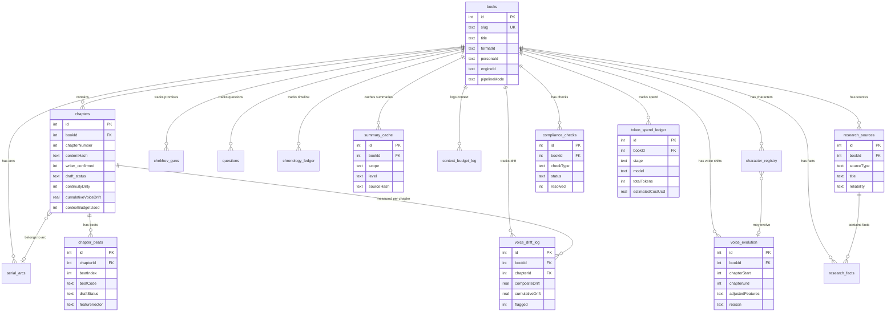

# AUTHR OS v3.0 — Complete Data Model & Schema v2.2 DDL

*Baseline Document — All tables required to build the project*

---

## 1. Database Architecture

| Database | Scope | Mode |
|:---|:---|:---|
| `craft_catalog.db` | Tier 0: Read-only reference catalog (25 Formats × 37 Personas × 18 Engines) | Shared across all projects |
| `story_bible.db` | Tier 1–3: Per-project transactional master (canon, beats, ledgers, voice, research, compliance) | One per `books/<Book_Slug>/` |

All connections execute:
```sql
PRAGMA journal_mode = WAL;
PRAGMA synchronous = NORMAL;
PRAGMA foreign_keys = ON;
```

---

## 2. Tier 0: Craft Catalog DDL (`craft_catalog.db`)

*Carried forward from v2.1 without modification.*

```sql
CREATE TABLE IF NOT EXISTS catalog_formats (
    id TEXT PRIMARY KEY,                  -- FMT_01 .. FMT_25
    key TEXT NOT NULL UNIQUE,
    name TEXT NOT NULL,
    target_words INTEGER NOT NULL,
    default_chapters INTEGER NOT NULL,
    pipeline_mode TEXT NOT NULL DEFAULT 'FICTION_NARRATIVE'
        CHECK (pipeline_mode IN ('FICTION_NARRATIVE', 'NONFICTION_AUTHORITY',
                                  'SCRIPT_VISUAL', 'INTERACTIVE_CYOA')),
    beat_model TEXT NOT NULL DEFAULT '7_BEAT_FICTION'
);

CREATE TABLE IF NOT EXISTS catalog_personas (
    id TEXT PRIMARY KEY,                  -- PER_01 .. PER_37
    name TEXT NOT NULL,
    pov_mode TEXT NOT NULL,
    tense_mode TEXT NOT NULL,
    voice_dna_json TEXT NOT NULL,         -- 4-Layer Voice Architecture JSON
    banned_lexicon_json TEXT NOT NULL
);

CREATE TABLE IF NOT EXISTS catalog_engines (
    id TEXT PRIMARY KEY,                  -- ENG_01 .. ENG_18
    name TEXT NOT NULL,
    beat_count INTEGER NOT NULL,
    spine_template_json TEXT NOT NULL
);
```

---

## 3. Tier 1–3: Project Master DDL (`story_bible.db`) — v2.1 Baseline

*Carried forward from v2.1 without modification. All existing columns preserved.*

```sql
-- ==========================================================================
-- CORE PROJECT TABLE
-- ==========================================================================

CREATE TABLE IF NOT EXISTS books (
    id INTEGER PRIMARY KEY AUTOINCREMENT,
    slug TEXT NOT NULL UNIQUE,
    title TEXT NOT NULL,
    subtitle TEXT,
    authorName TEXT NOT NULL DEFAULT 'Authr Studio',
    formatId TEXT NOT NULL DEFAULT 'FMT_01',
    personaId TEXT NOT NULL DEFAULT 'PER_01_HARD_BOILED_NOIR',
    engineId TEXT NOT NULL DEFAULT 'ENG_01_SAVE_THE_CAT_15',
    pipelineMode TEXT NOT NULL DEFAULT 'FICTION_NARRATIVE'
        CHECK (pipelineMode IN ('FICTION_NARRATIVE', 'NONFICTION_AUTHORITY',
                                 'SCRIPT_VISUAL', 'INTERACTIVE_CYOA')),
    freeTierChapters INTEGER NOT NULL DEFAULT 5,
    wordMin INTEGER NOT NULL DEFAULT 1000,
    wordMax INTEGER NOT NULL DEFAULT 2000,
    bufferTarget INTEGER NOT NULL DEFAULT 8,
    exportProfile TEXT NOT NULL DEFAULT 'royal_road',
    createdAt TEXT NOT NULL DEFAULT CURRENT_TIMESTAMP,
    updatedAt TEXT NOT NULL DEFAULT CURRENT_TIMESTAMP
);

-- ==========================================================================
-- SERIAL ARC MANAGEMENT
-- ==========================================================================

CREATE TABLE IF NOT EXISTS serial_arcs (
    id INTEGER PRIMARY KEY AUTOINCREMENT,
    bookId INTEGER NOT NULL REFERENCES books(id) ON DELETE CASCADE,
    arcIndex INTEGER NOT NULL,
    conflict TEXT NOT NULL,
    questionRef INTEGER,
    phaseBounds TEXT NOT NULL,            -- JSON: {setup, escalation, reversal, climax}
    answeredQuestionRef INTEGER,
    contribution TEXT,
    seeds TEXT                            -- JSON array of next-arc seeds
);

-- ==========================================================================
-- CHAPTERS
-- ==========================================================================

CREATE TABLE IF NOT EXISTS chapters (
    id INTEGER PRIMARY KEY AUTOINCREMENT,
    bookId INTEGER NOT NULL REFERENCES books(id) ON DELETE CASCADE,
    chapterNumber INTEGER NOT NULL,
    title TEXT NOT NULL,
    filePath TEXT NOT NULL,               -- e.g., chapters/chapter_01.md
    contentHash TEXT,                     -- SHA-256 digest of synchronized .md file (ADR-0012)
    writer_confirmed INTEGER NOT NULL DEFAULT 0,
    draft_status TEXT NOT NULL DEFAULT 'PROPOSED'
        CHECK (draft_status IN ('PROPOSED', 'CONFIRMED', 'ARCHIVED')),
    serialReleaseState TEXT NOT NULL DEFAULT 'BUFFER'
        CHECK (serialReleaseState IN ('FREE_TIER', 'BUFFER', 'PATREON_EARLY', 'PUBLISHED')),
    continuityDirty INTEGER NOT NULL DEFAULT 0,
    dirtyReason TEXT,                     -- JSON array of upstream causal mutations
    arcId INTEGER REFERENCES serial_arcs(id),
    endingType TEXT CHECK (endingType IN (
        'DANGER', 'EMOTIONAL_REVELATION', 'MYSTERY_DISCOVERY',
        'IRREVERSIBLE_CHOICE', 'REVERSAL', 'ANTICIPATION', 'QUIET',
        'FRAMEWORK_SYNTHESIS', 'PARADIGM_SHIFT', 'TACTICAL_CHALLENGE', 'BRIDGE_TO_APPLICATION'
    )),
    beatCoverage TEXT,                    -- JSON summary of beat completion
    balanceShares TEXT,                   -- JSON measured word-share percentages
    worksheet TEXT,                       -- JSON Pre-Draft Worksheet Sections A-E
    qcScores TEXT,                       -- JSON 7×0-2 Scorecard criteria
    qcTotal INTEGER CHECK (qcTotal BETWEEN 0 AND 14),
    burstinessScore REAL,                -- Measured sentence length SD (target >= 4.2)
    filterWordDensity REAL,              -- Measured Class-2 filter words per 1,000w (target < 3.0)
    hookCheck TEXT,                       -- JSON 200-400w opening hook scan (Ch 1-5)
    ctaNote TEXT,
    pollJson TEXT,
    UNIQUE(bookId, chapterNumber)
);

-- ==========================================================================
-- SUB-CHAPTER BEAT LOCKING (ADR-0012)
-- ==========================================================================

CREATE TABLE IF NOT EXISTS chapter_beats (
    id INTEGER PRIMARY KEY AUTOINCREMENT,
    chapterId INTEGER NOT NULL REFERENCES chapters(id) ON DELETE CASCADE,
    beatIndex INTEGER NOT NULL CHECK (beatIndex BETWEEN 1 AND 15),
    beatCode TEXT NOT NULL,               -- e.g., OPENING_HOOK, TURNING_POINT_PAYOFF
    beatSummary TEXT NOT NULL,
    targetSharePct REAL NOT NULL DEFAULT 14.0,
    actualWordCount INTEGER NOT NULL DEFAULT 0,
    charStartOffset INTEGER,
    charEndOffset INTEGER,
    contentHash TEXT,
    draftStatus TEXT NOT NULL DEFAULT 'PROPOSED'
        CHECK (draftStatus IN ('PROPOSED', 'CONFIRMED', 'LOCKED')),
    criticVetoFlag TEXT,                  -- NULL, CLARITY_ZERO, PAYOFF_ZERO, CLICHE_DENSITY, VOICE_DRIFT
    UNIQUE(chapterId, beatIndex)
);

-- ==========================================================================
-- CHARACTER REGISTRY (7 Attachment Elements + Speech Fingerprints)
-- ==========================================================================

CREATE TABLE IF NOT EXISTS character_registry (
    id INTEGER PRIMARY KEY AUTOINCREMENT,
    bookId INTEGER NOT NULL REFERENCES books(id) ON DELETE CASCADE,
    name TEXT NOT NULL,
    role TEXT NOT NULL,
    status TEXT NOT NULL DEFAULT 'ALIVE',
    attachmentElementsJson TEXT NOT NULL, -- JSON: Desire, Vulnerability, Contradiction, Relationships,
                                         --       Consequences, Agency, Growth
    speechFingerprint TEXT,               -- JSON: {max_words_per_turn, contraction_ratio, register,
                                         --        verbal_tics, forbidden_lexicon}
    voicePackPath TEXT,                   -- Optional path to .safetensors voice prompt
    ipaRespelling TEXT,                   -- e.g., "Aelyth -> AY-lith"
    lastConfirmedChapter INTEGER NOT NULL DEFAULT 0
);

-- ==========================================================================
-- MODE-POLYMORPHIC PROMISE / CHEKHOV GUN / CLAIM LEDGER
-- ==========================================================================

CREATE TABLE IF NOT EXISTS chekhov_guns (
    id INTEGER PRIMARY KEY AUTOINCREMENT,
    bookId INTEGER NOT NULL REFERENCES books(id) ON DELETE CASCADE,
    ledgerKind TEXT NOT NULL DEFAULT 'CHEKHOV_GUN'
        CHECK (ledgerKind IN ('CHEKHOV_GUN', 'THESIS_CLAIM_PROOF', 'CYOA_STATE_KEY')),
    name TEXT NOT NULL,
    description TEXT,
    status TEXT NOT NULL CHECK (status IN ('INTRODUCED', 'ESCALATED', 'RESOLVED', 'ORPHANED', 'WAIVED')),
    introducedChapter INTEGER NOT NULL,
    sourceRevisionHash TEXT,              -- Causal tracking hash (ADR-0012)
    escalationChapters TEXT,              -- JSON array of chapter numbers
    resolvedChapter INTEGER,
    quote TEXT,
    severity TEXT NOT NULL DEFAULT 'normal',
    waiveNote TEXT
);

-- ==========================================================================
-- 3-LEVEL QUESTION / COGNITIVE OBJECTION LEDGER
-- ==========================================================================

CREATE TABLE IF NOT EXISTS questions (
    id INTEGER PRIMARY KEY AUTOINCREMENT,
    bookId INTEGER NOT NULL REFERENCES books(id) ON DELETE CASCADE,
    level TEXT NOT NULL CHECK (level IN ('IMMEDIATE', 'PROGRESSIVE', 'LONG_TERM')),
    text TEXT NOT NULL,
    openedChapter INTEGER NOT NULL,
    sourceRevisionHash TEXT,
    dueChapter INTEGER,
    answeredChapter INTEGER,
    revelationCriteriaJson TEXT           -- JSON 6 Revelation Quality Criteria audit
);

-- ==========================================================================
-- CHRONOLOGY & TEMPORAL ENTITY STATE GRAPH
-- ==========================================================================

CREATE TABLE IF NOT EXISTS chronology_ledger (
    id INTEGER PRIMARY KEY AUTOINCREMENT,
    bookId INTEGER NOT NULL REFERENCES books(id) ON DELETE CASCADE,
    chapterNumber INTEGER NOT NULL,
    storyTimestamp TEXT NOT NULL,
    locationName TEXT NOT NULL,
    entityStateMutationsJson TEXT NOT NULL, -- JSON array of state transitions
    sourceRevisionHash TEXT NOT NULL
);

-- ==========================================================================
-- PLUGINS
-- ==========================================================================

CREATE TABLE IF NOT EXISTS plugins (
    id INTEGER PRIMARY KEY AUTOINCREMENT,
    kind TEXT NOT NULL CHECK (kind IN ('structure', 'persona')),
    name TEXT NOT NULL,
    path TEXT NOT NULL,
    version TEXT,
    enabled INTEGER NOT NULL DEFAULT 1
);
```

---

## 4. Schema v2.2 NEW Tables

```sql
-- ==========================================================================
-- [v3 NEW] VOICE EVOLUTION — Intentional voice profile shifts by chapter range
-- ==========================================================================
-- Allows authors to declare intentional tonal shifts (e.g., "darker tone from
-- Chapter 11") that suppress false voice drift alerts. Referenced by
-- retention_and_editorial.py during cumulative drift calculation (ADR-0013).

CREATE TABLE IF NOT EXISTS voice_evolution (
    id INTEGER PRIMARY KEY AUTOINCREMENT,
    bookId INTEGER NOT NULL REFERENCES books(id) ON DELETE CASCADE,
    personaId TEXT NOT NULL,              -- Which persona this evolution applies to
    chapterStart INTEGER NOT NULL,        -- First chapter of the evolution range
    chapterEnd INTEGER,                   -- Last chapter (NULL = to end of book)
    adjustedFeatures TEXT NOT NULL,        -- JSON: features that intentionally change
                                          -- e.g., {"target_burstiness": 5.5, "avg_sentence_len": 11,
                                          --        "tonal_shift": "darker", "contraction_freq": 0.8}
    reason TEXT NOT NULL,                  -- Human-readable: "Protagonist descends into grief arc"
    approvedBy TEXT NOT NULL DEFAULT 'author',  -- Who approved the evolution
    createdAt TEXT NOT NULL DEFAULT (datetime('now'))
);

-- ==========================================================================
-- [v3 NEW] VOICE DRIFT LOG — Per-chapter/beat drift tracking with cumulative EMA
-- ==========================================================================
-- Stores drift measurements for every generation pass. The cumulative_drift
-- column tracks the exponential moving average (α=0.1) across all chapters,
-- enabling detection of slow voice collapse (ADR-0013, Invariant 15).

CREATE TABLE IF NOT EXISTS voice_drift_log (
    id INTEGER PRIMARY KEY AUTOINCREMENT,
    bookId INTEGER NOT NULL REFERENCES books(id) ON DELETE CASCADE,
    chapterId INTEGER NOT NULL REFERENCES chapters(id) ON DELETE CASCADE,
    beatIndex INTEGER,                    -- NULL = chapter-level, INTEGER = beat-level
    profileType TEXT NOT NULL DEFAULT 'author'
        CHECK (profileType IN ('author', 'character', 'register')),
    profileName TEXT,                     -- e.g., 'AuthorMain' or character name
    measuredFeatures TEXT NOT NULL,        -- JSON: full feature vector of generated text
    perFeatureDrift TEXT NOT NULL,         -- JSON: {feature_name: drift_score} (0.0-1.0 each)
    compositeDrift REAL NOT NULL,          -- Weighted composite drift (0.0-1.0)
    cumulativeDrift REAL NOT NULL,         -- Running EMA: α·composite + (1-α)·prev_cumulative
    flagged INTEGER NOT NULL DEFAULT 0,   -- 1 if composite > 0.30 or cumulative > 0.20
    evolutionApplied INTEGER NOT NULL DEFAULT 0,  -- 1 if a voice_evolution was active & suppressed alert
    createdAt TEXT NOT NULL DEFAULT (datetime('now'))
);

-- ==========================================================================
-- [v3 NEW] SUMMARY CACHE — Multi-level hierarchical summaries for context assembly
-- ==========================================================================
-- Stores pre-computed summaries at four levels of compression for use by
-- the hierarchical context engine (ADR-0014). Cache invalidation is driven
-- by source_hash comparison: if the source content changes, the cached
-- summary is stale and must be regenerated.

CREATE TABLE IF NOT EXISTS summary_cache (
    id INTEGER PRIMARY KEY AUTOINCREMENT,
    bookId INTEGER NOT NULL REFERENCES books(id) ON DELETE CASCADE,
    scope TEXT NOT NULL,                   -- 'chapter:5', 'chapters:1-10', 'full_manuscript',
                                          -- 'worldbible', 'character:Elena'
    level TEXT NOT NULL
        CHECK (level IN ('full', 'medium', 'brief', 'oneliner')),
    summaryText TEXT NOT NULL,
    tokenCount INTEGER NOT NULL,
    sourceHash TEXT NOT NULL,              -- SHA-256 of source content (invalidation trigger)
    modelUsed TEXT,                        -- Which model generated this summary
    createdAt TEXT NOT NULL DEFAULT (datetime('now')),
    UNIQUE(bookId, scope, level)
);

-- ==========================================================================
-- [v3 NEW] CONTEXT BUDGET LOG — Token budget tracking per LLM invocation
-- ==========================================================================
-- Records how context tokens were allocated across the 9 layers for each
-- LLM call, enabling analysis of context utilization and optimization (ADR-0014).

CREATE TABLE IF NOT EXISTS context_budget_log (
    id INTEGER PRIMARY KEY AUTOINCREMENT,
    bookId INTEGER NOT NULL REFERENCES books(id) ON DELETE CASCADE,
    invocationId TEXT NOT NULL,            -- UUID for this specific LLM call
    stage TEXT NOT NULL,                   -- e.g., 'L4_SCENE_COMPOSER', 'L5_STYLE_POLISHER'
    chapterNumber INTEGER,
    beatIndex INTEGER,
    modelUsed TEXT NOT NULL,               -- Which LLM model was used
    modelMaxContext INTEGER NOT NULL,      -- Model's context window size
    layerAllocations TEXT NOT NULL,        -- JSON: {system_instructions: 5200, voice_profile: 5200,
                                          --        scene_plan: 5200, recent_manuscript: 26000,
                                          --        outline: 10400, worldbible: 15600,
                                          --        retrieved: 15600, editorial: 5200,
                                          --        foreshadowing: 5200}
    actualTokensUsed INTEGER NOT NULL,
    budgetUtilization REAL NOT NULL,       -- actual / available (0.0-1.0)
    summaryFallbackUsed INTEGER NOT NULL DEFAULT 0,  -- 1 if summarizer compressed to fit
    createdAt TEXT NOT NULL DEFAULT (datetime('now'))
);

-- ==========================================================================
-- [v3 NEW] RESEARCH SOURCES — External reference management (ADR-0015)
-- ==========================================================================
-- Stores ingested research sources for fact-checking and citation management.
-- Primary use: non-fiction (FMT_07–FMT_12), historical fiction, hard sci-fi.

CREATE TABLE IF NOT EXISTS research_sources (
    id INTEGER PRIMARY KEY AUTOINCREMENT,
    bookId INTEGER NOT NULL REFERENCES books(id) ON DELETE CASCADE,
    sourceType TEXT NOT NULL
        CHECK (sourceType IN ('url', 'pdf', 'book_reference', 'note', 'interview', 'dataset')),
    title TEXT NOT NULL,
    author TEXT,                           -- Source author/publisher
    url TEXT,                              -- URL if web source
    filePath TEXT,                         -- Local file path if PDF/document
    contentSnippet TEXT,                   -- Extracted or pasted key content
    tags TEXT,                             -- JSON array of topic tags
    citationFormat TEXT,                   -- JSON: pre-formatted citation (APA, Chicago, etc.)
    reliability TEXT NOT NULL DEFAULT 'unverified'
        CHECK (reliability IN ('verified', 'unverified', 'disputed', 'primary', 'secondary')),
    ingestedAt TEXT NOT NULL DEFAULT (datetime('now')),
    lastVerifiedAt TEXT
);

-- ==========================================================================
-- [v3 NEW] RESEARCH FACTS — Extracted facts linked to chapters (ADR-0015)
-- ==========================================================================
-- Individual facts extracted from research sources, tagged to the chapters
-- that reference them. Enables fact-checking and citation verification.

CREATE TABLE IF NOT EXISTS research_facts (
    id INTEGER PRIMARY KEY AUTOINCREMENT,
    bookId INTEGER NOT NULL REFERENCES books(id) ON DELETE CASCADE,
    sourceId INTEGER NOT NULL REFERENCES research_sources(id) ON DELETE CASCADE,
    factText TEXT NOT NULL,                -- The factual claim
    category TEXT,                         -- e.g., 'historical_date', 'scientific_claim', 'statistic'
    chapterRefs TEXT,                      -- JSON array of chapter numbers that cite this fact
    verified INTEGER NOT NULL DEFAULT 0,   -- 1 = fact-checked against source
    confidence REAL NOT NULL DEFAULT 0.5   -- 0.0-1.0 confidence in accuracy
        CHECK (confidence BETWEEN 0.0 AND 1.0),
    verificationNote TEXT,                 -- Human note on verification outcome
    createdAt TEXT NOT NULL DEFAULT (datetime('now'))
);

-- ==========================================================================
-- [v3 NEW] COMPLIANCE CHECKS — Pre-publication compliance results (ADR-0016)
-- ==========================================================================
-- Stores results of pre-publication compliance checks. Retail compilation
-- is blocked if any check has status='blocking' and resolved=0 (Invariant 18).

CREATE TABLE IF NOT EXISTS compliance_checks (
    id INTEGER PRIMARY KEY AUTOINCREMENT,
    bookId INTEGER NOT NULL REFERENCES books(id) ON DELETE CASCADE,
    checkType TEXT NOT NULL
        CHECK (checkType IN ('plagiarism', 'trademark', 'sensitivity', 'ai_disclosure',
                             'copyright', 'defamation')),
    scope TEXT,                            -- 'chapter:5', 'full_manuscript', 'character:Elena'
    status TEXT NOT NULL DEFAULT 'pending'
        CHECK (status IN ('pending', 'pass', 'warning', 'blocking')),
    findings TEXT,                         -- JSON array of specific findings
    recommendedActions Text,               -- JSON array of recommended fixes
    resolved INTEGER NOT NULL DEFAULT 0,   -- 1 = issue addressed or waived
    resolvedNote TEXT,                     -- How it was resolved (waiver, fix, etc.)
    checkedAt TEXT NOT NULL DEFAULT (datetime('now')),
    resolvedAt TEXT
);

-- ==========================================================================
-- [v3 NEW] TOKEN SPEND LEDGER — Per-project cost tracking (ADR-0014)
-- ==========================================================================
-- Tracks actual token consumption and estimated cost per LLM invocation,
-- enabling per-project and per-stage cost analysis and budget alerts.

CREATE TABLE IF NOT EXISTS token_spend_ledger (
    id INTEGER PRIMARY KEY AUTOINCREMENT,
    bookId INTEGER NOT NULL REFERENCES books(id) ON DELETE CASCADE,
    stage TEXT NOT NULL,                   -- e.g., 'L4_SCENE_COMPOSER', 'SUMMARIZER', 'COMPLIANCE'
    weaverEngine TEXT,                     -- Which of the 6 weavers
    specialistRole TEXT,                   -- Which of the 22 roles
    chapterNumber INTEGER,
    beatIndex INTEGER,
    model TEXT NOT NULL,                   -- Model identifier
    provider TEXT NOT NULL,                -- openai, ollama, gemini, mistral
    promptTokens INTEGER NOT NULL,
    completionTokens INTEGER NOT NULL,
    totalTokens INTEGER NOT NULL,
    estimatedCostUsd REAL,                -- Estimated cost in USD (NULL if local model)
    createdAt TEXT NOT NULL DEFAULT (datetime('now'))
);
```

---

## 5. Schema v2.2 Column Additions to Existing Tables

```sql
-- Add cumulative voice drift tracking to chapters
ALTER TABLE chapters ADD COLUMN cumulativeVoiceDrift REAL;
-- Running EMA drift score at chapter confirmation (ADR-0013)

-- Add context budget tracking to chapters
ALTER TABLE chapters ADD COLUMN contextBudgetUsed INTEGER;
-- Total tokens used for context assembly in this chapter's generation

-- Add voice evolution reference to character_registry
ALTER TABLE character_registry ADD COLUMN voiceEvolutionId INTEGER
    REFERENCES voice_evolution(id);
-- FK to voice_evolution for characters with intentional voice shifts

-- Add expanded feature vector to chapter_beats
ALTER TABLE chapter_beats ADD COLUMN featureVector TEXT;
-- JSON of 20+ extracted NLP features per beat:
-- {sentence_len_mean, sentence_len_sd, clause_depth_avg, punct_rhythm,
--  opener_variety, hapax_ratio, ttr_windowed, figurative_density,
--  sensory_by_sense, passive_freq, adverb_freq, contraction_freq,
--  dialogue_ratio, show_tell_ratio, narrative_distance, pov_consistency,
--  tense_consistency, emotional_valence_curve, word_len_avg}
```

---

## 6. Migration Script (ADR-0002 Compliant)

```python
"""
Schema v2.1 → v2.2 Migration
Follows ADR-0002: additive-only, atomic backup before migration.
"""
import sqlite3
import shutil
from datetime import datetime
from pathlib import Path

MIGRATION_VERSION = "2.2"

NEW_TABLES_DDL = [
    # voice_evolution
    """CREATE TABLE IF NOT EXISTS voice_evolution (
        id INTEGER PRIMARY KEY AUTOINCREMENT,
        bookId INTEGER NOT NULL REFERENCES books(id) ON DELETE CASCADE,
        personaId TEXT NOT NULL,
        chapterStart INTEGER NOT NULL,
        chapterEnd INTEGER,
        adjustedFeatures TEXT NOT NULL,
        reason TEXT NOT NULL,
        approvedBy TEXT NOT NULL DEFAULT 'author',
        createdAt TEXT NOT NULL DEFAULT (datetime('now'))
    )""",
    # voice_drift_log
    """CREATE TABLE IF NOT EXISTS voice_drift_log (
        id INTEGER PRIMARY KEY AUTOINCREMENT,
        bookId INTEGER NOT NULL REFERENCES books(id) ON DELETE CASCADE,
        chapterId INTEGER NOT NULL REFERENCES chapters(id) ON DELETE CASCADE,
        beatIndex INTEGER,
        profileType TEXT NOT NULL DEFAULT 'author'
            CHECK (profileType IN ('author', 'character', 'register')),
        profileName TEXT,
        measuredFeatures TEXT NOT NULL,
        perFeatureDrift TEXT NOT NULL,
        compositeDrift REAL NOT NULL,
        cumulativeDrift REAL NOT NULL,
        flagged INTEGER NOT NULL DEFAULT 0,
        evolutionApplied INTEGER NOT NULL DEFAULT 0,
        createdAt TEXT NOT NULL DEFAULT (datetime('now'))
    )""",
    # summary_cache
    """CREATE TABLE IF NOT EXISTS summary_cache (
        id INTEGER PRIMARY KEY AUTOINCREMENT,
        bookId INTEGER NOT NULL REFERENCES books(id) ON DELETE CASCADE,
        scope TEXT NOT NULL,
        level TEXT NOT NULL CHECK (level IN ('full', 'medium', 'brief', 'oneliner')),
        summaryText TEXT NOT NULL,
        tokenCount INTEGER NOT NULL,
        sourceHash TEXT NOT NULL,
        modelUsed TEXT,
        createdAt TEXT NOT NULL DEFAULT (datetime('now')),
        UNIQUE(bookId, scope, level)
    )""",
    # context_budget_log
    """CREATE TABLE IF NOT EXISTS context_budget_log (
        id INTEGER PRIMARY KEY AUTOINCREMENT,
        bookId INTEGER NOT NULL REFERENCES books(id) ON DELETE CASCADE,
        invocationId TEXT NOT NULL,
        stage TEXT NOT NULL,
        chapterNumber INTEGER,
        beatIndex INTEGER,
        modelUsed TEXT NOT NULL,
        modelMaxContext INTEGER NOT NULL,
        layerAllocations TEXT NOT NULL,
        actualTokensUsed INTEGER NOT NULL,
        budgetUtilization REAL NOT NULL,
        summaryFallbackUsed INTEGER NOT NULL DEFAULT 0,
        createdAt TEXT NOT NULL DEFAULT (datetime('now'))
    )""",
    # research_sources
    """CREATE TABLE IF NOT EXISTS research_sources (
        id INTEGER PRIMARY KEY AUTOINCREMENT,
        bookId INTEGER NOT NULL REFERENCES books(id) ON DELETE CASCADE,
        sourceType TEXT NOT NULL
            CHECK (sourceType IN ('url', 'pdf', 'book_reference', 'note', 'interview', 'dataset')),
        title TEXT NOT NULL,
        author TEXT,
        url TEXT,
        filePath TEXT,
        contentSnippet TEXT,
        tags TEXT,
        citationFormat TEXT,
        reliability TEXT NOT NULL DEFAULT 'unverified'
            CHECK (reliability IN ('verified', 'unverified', 'disputed', 'primary', 'secondary')),
        ingestedAt TEXT NOT NULL DEFAULT (datetime('now')),
        lastVerifiedAt TEXT
    )""",
    # research_facts
    """CREATE TABLE IF NOT EXISTS research_facts (
        id INTEGER PRIMARY KEY AUTOINCREMENT,
        bookId INTEGER NOT NULL REFERENCES books(id) ON DELETE CASCADE,
        sourceId INTEGER NOT NULL REFERENCES research_sources(id) ON DELETE CASCADE,
        factText TEXT NOT NULL,
        category TEXT,
        chapterRefs TEXT,
        verified INTEGER NOT NULL DEFAULT 0,
        confidence REAL NOT NULL DEFAULT 0.5 CHECK (confidence BETWEEN 0.0 AND 1.0),
        verificationNote TEXT,
        createdAt TEXT NOT NULL DEFAULT (datetime('now'))
    )""",
    # compliance_checks
    """CREATE TABLE IF NOT EXISTS compliance_checks (
        id INTEGER PRIMARY KEY AUTOINCREMENT,
        bookId INTEGER NOT NULL REFERENCES books(id) ON DELETE CASCADE,
        checkType TEXT NOT NULL
            CHECK (checkType IN ('plagiarism', 'trademark', 'sensitivity', 'ai_disclosure',
                                 'copyright', 'defamation')),
        scope TEXT,
        status TEXT NOT NULL DEFAULT 'pending'
            CHECK (status IN ('pending', 'pass', 'warning', 'blocking')),
        findings TEXT,
        recommendedActions TEXT,
        resolved INTEGER NOT NULL DEFAULT 0,
        resolvedNote TEXT,
        checkedAt TEXT NOT NULL DEFAULT (datetime('now')),
        resolvedAt TEXT
    )""",
    # token_spend_ledger
    """CREATE TABLE IF NOT EXISTS token_spend_ledger (
        id INTEGER PRIMARY KEY AUTOINCREMENT,
        bookId INTEGER NOT NULL REFERENCES books(id) ON DELETE CASCADE,
        stage TEXT NOT NULL,
        weaverEngine TEXT,
        specialistRole TEXT,
        chapterNumber INTEGER,
        beatIndex INTEGER,
        model TEXT NOT NULL,
        provider TEXT NOT NULL,
        promptTokens INTEGER NOT NULL,
        completionTokens INTEGER NOT NULL,
        totalTokens INTEGER NOT NULL,
        estimatedCostUsd REAL,
        createdAt TEXT NOT NULL DEFAULT (datetime('now'))
    )""",
]

COLUMN_ADDITIONS = [
    ("chapters", "cumulativeVoiceDrift", "REAL"),
    ("chapters", "contextBudgetUsed", "INTEGER"),
    ("character_registry", "voiceEvolutionId", "INTEGER"),
    ("chapter_beats", "featureVector", "TEXT"),
]

def migrate_v21_to_v22(db_path: str) -> dict:
    """Migrate story_bible.db from Schema v2.1 to v2.2."""
    db = Path(db_path)
    
    # ADR-0002: Atomic backup before migration
    backup = db.with_suffix(f".db.bak.{datetime.now().strftime('%Y%m%d_%H%M%S')}")
    shutil.copy2(db, backup)
    
    conn = sqlite3.connect(str(db))
    conn.execute("PRAGMA journal_mode = WAL")
    conn.execute("PRAGMA foreign_keys = ON")
    
    results = {"backup": str(backup), "tables_created": [], "columns_added": [], "errors": []}
    
    try:
        # Create new tables
        for ddl in NEW_TABLES_DDL:
            table_name = ddl.split("EXISTS")[1].split("(")[0].strip()
            try:
                conn.execute(ddl)
                results["tables_created"].append(table_name)
            except sqlite3.OperationalError as e:
                results["errors"].append(f"{table_name}: {e}")
        
        # Add columns to existing tables
        for table, column, col_type in COLUMN_ADDITIONS:
            try:
                conn.execute(f"ALTER TABLE {table} ADD COLUMN {column} {col_type}")
                results["columns_added"].append(f"{table}.{column}")
            except sqlite3.OperationalError as e:
                if "duplicate column" not in str(e).lower():
                    results["errors"].append(f"{table}.{column}: {e}")
        
        # Create indexes (Section 7)
        for idx_sql in INDEX_DDL:
            try:
                conn.execute(idx_sql)
            except sqlite3.OperationalError:
                pass  # Index may already exist
        
        conn.commit()
    except Exception as e:
        conn.rollback()
        results["errors"].append(f"ROLLBACK: {e}")
        # Restore from backup
        shutil.copy2(backup, db)
    finally:
        conn.close()
    
    return results
```

---

## 7. Performance Indexes

```sql
INDEX_DDL = [
    -- Voice drift lookups by chapter
    "CREATE INDEX IF NOT EXISTS idx_voice_drift_chapter ON voice_drift_log(bookId, chapterId)",
    "CREATE INDEX IF NOT EXISTS idx_voice_drift_flagged ON voice_drift_log(bookId, flagged) WHERE flagged = 1",

    -- Summary cache lookups
    "CREATE INDEX IF NOT EXISTS idx_summary_cache_scope ON summary_cache(bookId, scope, level)",

    -- Context budget analysis
    "CREATE INDEX IF NOT EXISTS idx_context_budget_stage ON context_budget_log(bookId, stage)",

    -- Research fact verification
    "CREATE INDEX IF NOT EXISTS idx_research_facts_verified ON research_facts(bookId, verified) WHERE verified = 0",
    "CREATE INDEX IF NOT EXISTS idx_research_facts_source ON research_facts(sourceId)",

    -- Compliance blocking checks
    "CREATE INDEX IF NOT EXISTS idx_compliance_blocking ON compliance_checks(bookId, status, resolved)
        WHERE status = 'blocking' AND resolved = 0",

    -- Token spend analysis by stage and model
    "CREATE INDEX IF NOT EXISTS idx_token_spend_stage ON token_spend_ledger(bookId, stage)",
    "CREATE INDEX IF NOT EXISTS idx_token_spend_model ON token_spend_ledger(bookId, model)",

    -- Voice evolution by chapter range
    "CREATE INDEX IF NOT EXISTS idx_voice_evolution_range ON voice_evolution(bookId, chapterStart, chapterEnd)",

    -- Existing table improvements
    "CREATE INDEX IF NOT EXISTS idx_chapters_dirty ON chapters(bookId, continuityDirty) WHERE continuityDirty = 1",
    "CREATE INDEX IF NOT EXISTS idx_chekhov_orphaned ON chekhov_guns(bookId, status) WHERE status = 'ORPHANED'",
]
```

---

## 8. Entity-Relationship Diagram



---

*End of Schema v2.2 DDL Specification.*
